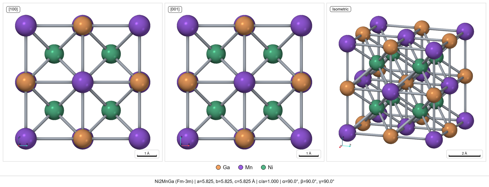
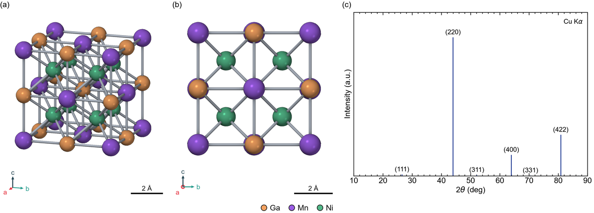
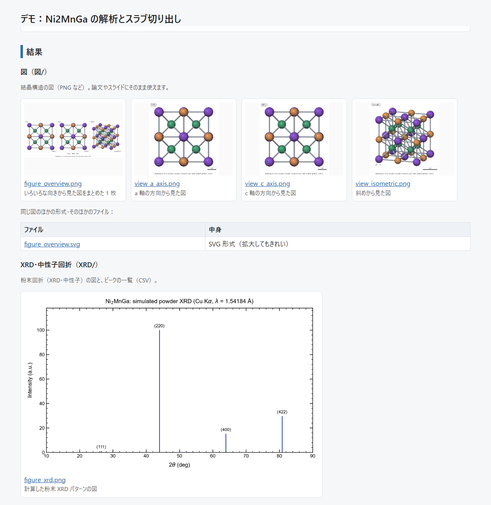

# Shido

**Shido generates publication-quality crystal structure figures and analyses from CIF files on Windows (GUI / CLI / MCP).**

**English** | [日本語](README_ja.md) (the Japanese README is the full manual)



| Journal-ready panel figure (Acta Materialia, double column) | Report page generated for every run |
|---|---|
|  |  |

## What it does

Load a CIF and Shido produces figures and tables you can put straight into a paper:

- **Structure figures** from three directions (PNG 300 dpi, editable SVG; TIFF/PDF/EPS on request), ball-and-stick, space-filling, stick or wireframe, with coordination polyhedra, lattice planes, magnetic-moment vectors and isosurfaces (CHGCAR, Cube, XSF, VESTA .grd)
- **Journal-formatted figures**: panels laid out at the journal's column width and dpi, with its panel-label style and file format, plus an automatic check (`journals/*.yaml`: Nature, Acta Materialia, Physical Review, APL, Chem. Mater., …)
- **Analyses as CSV/JSON**: lattice parameters, bond lengths and angles, symmetry (space group, operations, Wyckoff), polyhedra and bond-valence sums, Madelung energy, structure factors, ADPs, simulated powder XRD / neutron patterns (with peak profiles and overlay on measured data)
- **Surface slabs** cut along any (h k l), **two-phase comparison** (austenite/martensite) with lattice strain, **Heusler sublattice models** (L21 / B2 / XA), **DFT c/a sweeps** at constant volume (POSCAR/CIF)
- **3D models**: STL for 3D printing, rotatable offline HTML
- **Reproducibility**: every run writes a `recipe.json` (versions, all arguments, SHA-256 of inputs and outputs) so the same figure can be rebuilt with `server.py rerun`, plus a draft sentence for the Methods section
- **Safety checks**: runs stop instead of saving wrong results (bad Miller indices, overlapping atoms, composition drift, blank images, …). 527 tests

Three ways to use it: a **GUI**, a **command line**, and an **MCP server** so Claude (Claude Code / Claude Desktop) can call it directly.

## Quick start (Windows)

### Option A: download the exe (no Python needed)

Download `Shido-<version>-windows-x64.zip` from the [Releases](https://github.com/Toror0/shido/releases) page, unzip it to a folder you can write to (e.g. Documents, not `C:\Program Files`) and run `Shido\Shido.exe`. This is the GUI only.

- The exe is not code-signed, so Windows SmartScreen may say "Windows protected your PC": click **More info → Run anyway**
- Results go to `出力\` next to `Shido.exe`; GUI settings are saved to `settings_user.yaml` there too

### Option B: from source

1. Install **Python 3.13 for Windows** from python.org (3.11–3.13 work)
2. Double-click **`setup_windows.bat`** (creates `.venv` and installs the dependencies; the first run takes a few minutes)
3. Double-click **`launch_gui.vbs`** to open the GUI

Command line (PowerShell, in this folder):

```powershell
# Demo with Ni2MnGa: three views + (111) slab (+ XRD)
.\.venv\Scripts\python.exe server.py demo --xrd

# Analyse one CIF and cut a (110) slab
.\.venv\Scripts\python.exe server.py my.cif --hkl 1 1 0

# Process every CIF in a folder
.\.venv\Scripts\python.exe server.py batch .\cifs --plane 111

# Journal-formatted figure
.\.venv\Scripts\python.exe server.py figure --journal acta_materialia --width double --panels "bulk:iso,bulk:a,xrd" --cif my.cif
.\.venv\Scripts\python.exe server.py figure --list

# All options
.\.venv\Scripts\python.exe server.py --help
```

Each run creates a new folder `出力\<date-time>_<name>\` ("出力" = output). Open **`はじめに読む.html`** ("read me first") inside it: one offline page with the settings, thumbnails, XRD, links to the 3D model and every data file.

| Folder | Contents |
|---|---|
| `図/` (figures) | structure figures (PNG, SVG, …) |
| `XRD/` | XRD / neutron patterns and peak CSV |
| `3D/` | HTML / STL / VRML models |
| `数値/` (numbers) | CSV and JSON tables |
| `構造/` (structures) | CIF, POSCAR, XYZ, … |

### Use from Claude Code (MCP)

```powershell
claude mcp add shido -s user -- C:\path\to\shido\.venv\Scripts\python.exe C:\path\to\shido\server.py
```

Then ask Claude, e.g. "Analyse my.cif with shido and make an Acta Materialia figure". The tool list (`analyze_structure`, `generate_slabs`, `compute_xrd_pattern`, `make_journal_figure`, `get_symmetry_info`, `rerun_recipe`, …) is in the [Japanese README](README_ja.md#使えるツールmcp).

## Notes

- Windows only (not tested on Linux/macOS)
- The GUI, log messages and output folder names are in Japanese; figures, CSV headers and the Methods sentence are in English
- Known limitations are listed in the [Japanese README, section 7](README_ja.md#7-分かっている弱点まだ直していないこと)

## Feedback

- Bugs and feature requests (including new journal formats): [Issues](https://github.com/Toror0/shido/issues/new/choose) — templates are provided
- Questions, ideas and results: [Discussions](https://github.com/Toror0/shido/discussions)
- No GitHub account? Use the [feedback form](https://docs.google.com/forms/d/e/1FAIpQLSfnEYR0vR2WWtVOT7VwiziH3_4tDA_YTRjbl1w6Rl-uT5mI4Q/viewform)

English or Japanese is fine. Please do not post unpublished or confidential structures.

## License

[Apache-2.0](LICENSE)
