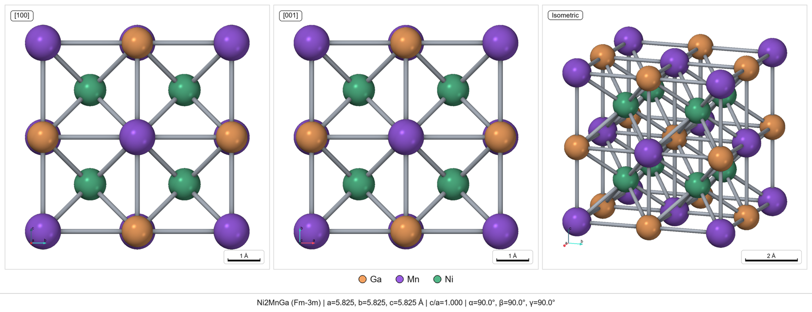
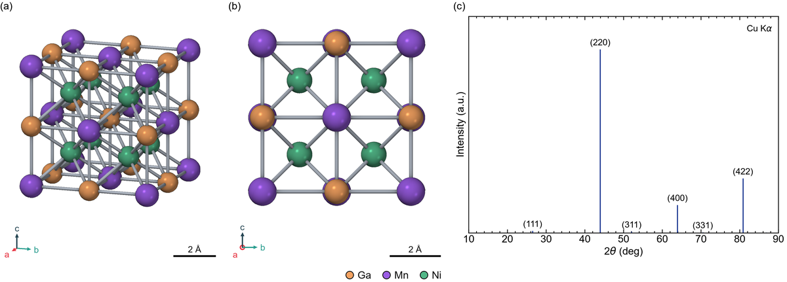
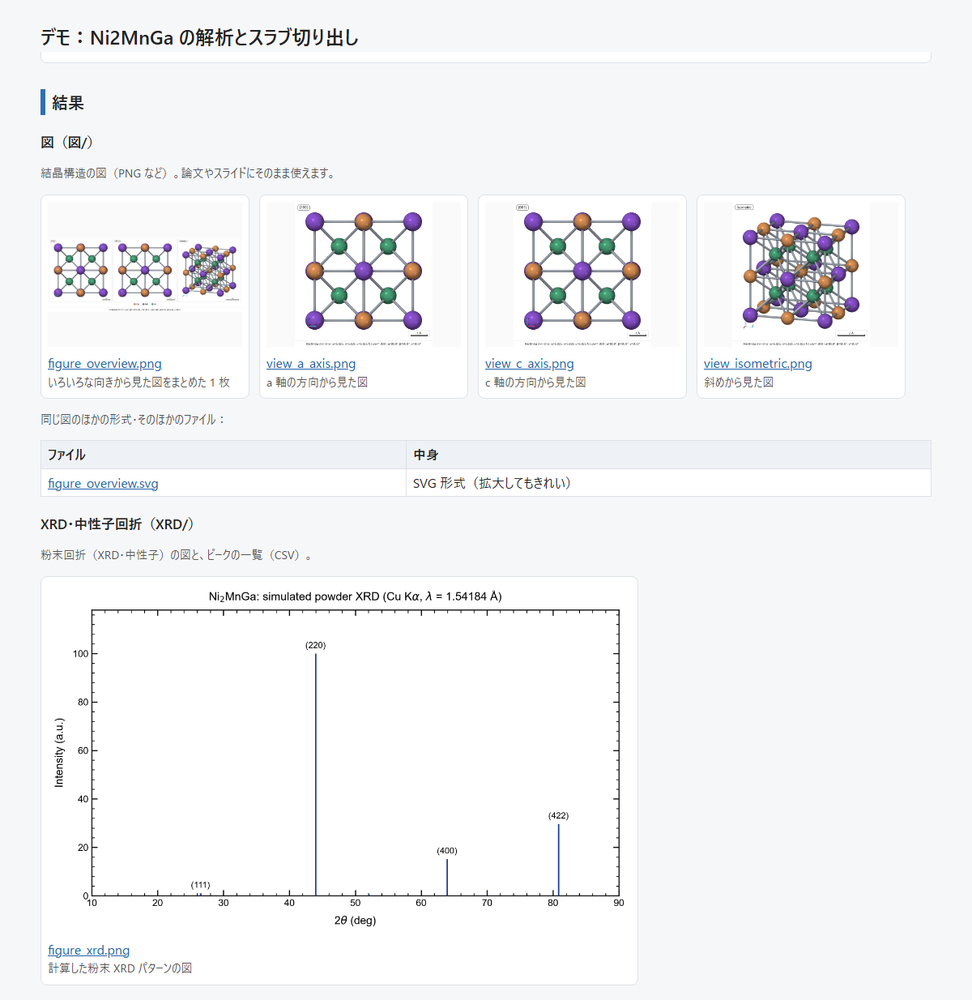

# Shido

**Shido** — CIF から論文品質の結晶構造図と解析を自動生成する Windows 用ツール（GUI / CLI / MCP 対応）。
*Shido generates publication-quality crystal structure figures and analyses from CIF files on Windows (GUI / CLI / MCP).*

[English](README.md) | **日本語**



| 雑誌の決まりどおりに仕上げた図（Acta Materialia・2段幅） | 実行ごとにできる「はじめに読む.html」 |
|---|---|
|  |  |

すぐ試したいときは、[Releases](https://github.com/Toror0/shido/releases) の Windows 用 exe（Python を入れなくても動く画面版）を使えます。
`Shido-<版>-windows-x64.zip` を書き込めるフォルダ（ドキュメントなど。`C:\Program Files` は避ける）に解凍し、`Shido\Shido.exe` を起動します。
「Windows によって PC が保護されました」と出たら、署名をしていないためなので「詳細情報」→「実行」を押してください。
結果は `Shido.exe` の横の `出力\` に、画面で変えた設定は同じ場所の `settings_user.yaml` に保存されます。

バージョン：**3.0.0**（番号は `shido/core/__init__.py` の `__version__` 1か所で決めています。`server.py --version` で確かめられます）

結晶構造のファイル（CIF）を読み込んで、論文に載せられる品質の図と数値の表を自動で作る道具です。
結晶の立体図（3方向からの図）、表面の切り出し（スラブ）、変態前後の2つの相の比べ図、
ホイスラー合金の原子の並べ方のパターン、DFT 計算（第一原理計算）用の c/a を変えた構造一式などを作れます。
画面（GUI）から使うほか、コマンドからも、Claude Code から「MCP サーバー」としても呼べます。
**Windows 専用**です（Linux・WSL では使いません）。

---

## 1. 準備（最初の1回だけ）

1. python.org から **Windows 用の Python 3.13** を入れる（3.11〜3.13 なら動きます）
2. このフォルダの **`setup_windows.bat` をダブルクリック**

`setup_windows.bat` がすること：

- このフォルダに `.venv`（この道具専用の Python の箱）を作る。Python は `py` コマンドで 3.13 → 3.12 → 3.11 の順に探す
- `requirements.txt` に書いた部品（pymatgen・pyvista など）を入れる。初回は数分かかる
  - 動作確認した版（2026-11）：pymatgen 2026.10.24 / pyvista 0.49.2 / vtk 9.7.2 / numpy 2.5.5 / pandas 3.1.1 / matplotlib 3.11.2 / pillow 13.0.0 / PyYAML 6.0.4 / mcp 2.3.0
- 部品が読み込めるか確かめて、使い方を表示する

何回実行しても大丈夫です。部品を足したときや、調子が悪いときにもう一度実行してください。
「.venv の Python が 3.11〜3.13 ではない」と出たら、`.venv` フォルダを消してから実行し直します。

## 2. 画面（GUI）を開く

**`launch_gui.vbs` をダブルクリック**します（黒い画面は出ません）。
うまく開かないときは `launch_gui.bat` を試してください。

画面には2つのタブがあります。

### 「実行」タブ

1. **実行モード**を選ぶ
   - 基本解析＋スラブ切り出し：立体図・結合の長さの表と、指定した面で切った表面（スラブ）
   - 変態前後 2相比較：母相とマルテンサイト相を同じ縮尺で並べ、格子のひずみを表にする
   - ホイスラー副格子モデル：組成式から原子の並べ方を何通りか作り、指定したペア（例: Mn–Mn）の距離を調べる
   - DFT c/a スイープ：体積を変えずに c/a を少しずつ変えた構造ファイル一式を作る
   - フォルダ一括バッチ：フォルダの中の CIF をまとめて処理する
2. **入力データ**：CIF ファイルかフォルダを選ぶ。空のままだと Ni2MnGa のお手本構造を使う
3. モードに合わせて出る欄（切る面のミラー指数、ホイスラーの組成式など）を入れる
4. カラーテーマ・背景の透過を選ぶ
5. （v3）「追加の出力」で XRD・STL・HTML を出すかと、POSCAR の格子（入力のまま／規約格子／基本格子）を選ぶ。
   部分占有の構造で規約格子・基本格子を選ぶと注意が出ます（組成がずれることがあるので「入力のまま」がおすすめ）
6. 「▶ 解析・図表を自動出力する」。読み込みの注意（原点の選び方の自動判定など）は実行ログに日本語で出ます
7. 終わったら「保存先」に場所が出ます。「フォルダを開く」か「はじめに読む.html を開く」で結果を見る
   （「出力先フォルダ」を空欄にしておくと、毎回 `出力\日時_名前\` に新しく作ります）

### 「前提数値」タブ

計算や図に使う「よく使う数値」をまとめて変えられます。長さは Å、角度は度です。

| まとまり | 中身 |
|---|---|
| よく使う材料 | Ni2MnGa・Co2MnSi などを選ぶと格子定数 a を入れてくれる |
| 格子定数・構造 | 母相の a、マルテンサイトの c/a、ホイスラーモデルの a |
| c/a スイープ | c/a の最小・最大・刻み（c/a = 1.00 を必ず含む） |
| スラブ | スラブの厚さ、真空層（原子のない空間）の厚さ、極性面（電気的に片寄った面）を除くか、同じ形をまとめるか |
| 変態前後の2相比較 | 2つの格子を対応づけるときの許容差（長さ・原子位置・角度） |
| ホイスラー副格子モデル | 組成式、規則度（L21 / B2 / XA＝逆ホイスラー）、スーパーセル（単位格子を何倍に並べるか）、パターン数、強調するペア、乱数の種 |
| 結合 | 結合の線を描く最大の距離 |
| 図の見た目 | カラーテーマ、解像度（dpi）、球・棒・枠線の太さ、背景の透過 |
| 表示用の原子半径 | 球の大きさの元。共有結合半径・金属結合半径のボタンで入れ替えられる |

- 「保存」を押すと、変えた値だけが **`settings_user.yaml`** に保存されます（このPCだけ。Git には入れません）
- 元の値（既定値）は **`settings_defaults.yaml`** にあります。こちらは書き換えません
- **「すべて既定値に戻す」** で `settings_user.yaml` の変更を捨てて元に戻せます
- 「変更を取り消す」は、保存する前の入力を元に戻します

## 3. コマンドで使う

このフォルダで PowerShell を開いて実行します。結果は毎回 `出力\日時_名前\` にできます（「5. どこに保存されるか」。`--out-dir` で変更可）。

```powershell
# お手本（Ni2MnGa）で一通り：立体図＋(111) スラブ
.\.venv\Scripts\python.exe server.py demo

# 2相比較・ホイスラー・c/a スイープをまとめてお手本実行
.\.venv\Scripts\python.exe server.py demo-v2 --theme okabe_ito_safe

# CIF 1つを解析して (110) 面で切る
.\.venv\Scripts\python.exe server.py my.cif --hkl 1 1 0

# フォルダの CIF をまとめて処理（面はプリセット名でも指定可）
.\.venv\Scripts\python.exe server.py batch .\cifs --plane 111

# 面のプリセット一覧 / 質問に答えて進むメニュー
.\.venv\Scripts\python.exe server.py planes
.\.venv\Scripts\python.exe server.py interactive

# 使えるオプションの一覧
.\.venv\Scripts\python.exe server.py --help

# 測る：2原子で距離・3原子で角度・4原子で二面角、2つの面の角度、best plane（@ のあとは隣のセルへのずれ）
.\.venv\Scripts\python.exe server.py measure my.cif --atoms Na1 Na1@0,0,1 --planes "1 0 0" "1 1 0" --best-plane 1 2 3

# 対称の情報表：空間群・対称操作（x,y,z の一覧）・Wyckoff・多重度・サイト対称（JSON と CSV も保存）
# 下の例はどれも、--out-dir を付けなければ 出力\日時_symmetry_my\ のような新しいフォルダに保存されます
.\.venv\Scripts\python.exe server.py symmetry my.cif

# セルの変換：Niggli・標準化・行列 P（分数も可）と原点のずれ・スーパーセル（CIF と POSCAR も保存）
.\.venv\Scripts\python.exe server.py transform my.cif --cell niggli --supercell 2 2 1 --out-dir .\out_cell

# 多面体の数値（体積・歪み・二次伸長・角度分散・ECoN）と結合原子価和、--madelung でマーデルング（--oxi Na=1,Cl=-1 で酸化数を指定）
.\.venv\Scripts\python.exe server.py polyhedra my.cif --madelung --out-dir .\out_poly

# 構造因子 F(hkl) の表（|F|・位相・F²・d・2θ・多重度・消滅）。--radiation neutron で中性子、--b Na=0.5,Cl=0.6 で温度因子 B
.\.venv\Scripts\python.exe server.py structure-factors my.cif --dmin 0.8 --out-dir .\out_sf

# 熱振動（ADP）の表：CIF の U_ij・B_ij・β_ij・U_iso・B_iso から U_eq・主軸の長さと向き・確率 50% の楕円体の半径
.\.venv\Scripts\python.exe server.py displacement my.cif --probability 50 --out-dir .\out_adp

# データの書き出し：XYZ・P1 の CIF・XTL・PDB・VRML（色つき *.wrl）・まとめた CIF（複数の CIF を1つに）
.\.venv\Scripts\python.exe server.py export a.cif b.cif --formats xyz,p1,xtl,pdb,wrl,multicif --out-dir .\out_export
```

主なオプション：`--hkl H K L`（ミラー指数）、`--plane 111`（面のプリセット）、`--out-dir`（出力先）、
`--theme`（カラーテーマ）、`--transparent`（背景透過）、`--no-polyhedra`（配位多面体を描かない）／`--polyhedra`（必ず描く）。
どちらも付けないときは、陰イオンになる元素（O・N・S・ハロゲン・P・As・Se・Te・C・B・H）がある構造だけ多面体を描きます（金属・金属間化合物では描かない）。
`--keep-polar`（極性面も残す）、`--no-dedup`（同じ形のスラブもまとめない）、
`--min-slab-size` / `--min-vacuum-size`（厚さ [Å]）。

v3 で足したオプション（付けたときだけ出ます。`demo`・CIF 1つ・`batch` のどれでも効きます）：
`--xrd`（XRD）、`--wavelength MoKa`（線源か波長 Å。付けると XRD も出す）、`--stl`、`--stl-split`（元素ごと）、
`--stl-max-mm 80`（この大きさに収める）、`--html`（回せる 3D）、`--poscar-cell {input,conventional,primitive}`、
`--all-blocks`（CIF の全データブロックを別々のフォルダで処理）、`--version`。

## 4. Claude Code に登録する（MCP サーバー）

MCP は、Claude がこの道具を直接呼び出すための仕組みです。PowerShell で1回だけ実行します。
（`--` のあとが「起動するコマンド」。パスは自分のPCの場所に合わせてください）

```powershell
claude mcp add shido -s user -- C:\path\to\shido\.venv\Scripts\python.exe C:\path\to\shido\server.py
```

- `-s user`：どのフォルダで Claude Code を開いても使える。このフォルダだけでよいなら `-s user` を消す
- 確かめる：`claude mcp list`（shido が Connected になればOK）
- 消す：`claude mcp remove shido -s user`
- `server.py` を引数なしで起動すると MCP サーバーとして待ち受けます。図や表は、出力先を指定しないと **`shido\出力\日時_名前\`** にでき、返り値の `output_dir` と `index_html`（はじめに読む.html）で場所が分かります

### 使えるツール（MCP）

| ツール | すること |
|---|---|
| `analyze_structure` | CIF を解析して立体図・格子定数・結合の長さの表を作る。`show_polyhedra` を省くと、陰イオンになる元素がある構造だけ配位多面体を描く（`true`／`false` で指定も可） |
| `generate_slabs` | CIF を指定のミラー指数 (h k l) で切ってスラブを作る |
| `run_ni2mnga_demo` | Ni2MnGa のお手本で解析＋スラブを一通り行う |
| `batch_analyze_cifs` | フォルダの CIF をまとめて処理し、まとめの表と一覧画像を作る |
| `compare_transformation_phases` | 母相とマルテンサイトの CIF を並べて比べ、ひずみを表にする |
| `generate_heusler_sublattice_models` | ホイスラー合金の原子の並べ方を何通りか作り、ペアの距離を調べる |
| `generate_dft_ca_sweep` | 体積一定で c/a を変えた POSCAR/CIF 一式を作る |
| `plot_dft_ca_energy_curve` | DFT のエネルギーの CSV から ΔE と c/a のグラフを描く |
| `get_assumed_parameters` | 今使っている前提数値を見る |
| `set_assumed_parameters` | 前提数値を変える（GUI と同じく settings_user.yaml に保存） |
| `reset_assumed_parameters` | 前提数値を既定値に戻す |
| `list_color_themes` | カラーテーマの一覧と、今のテーマを見る |
| `set_color_theme` | カラーテーマを変える |
| `list_major_planes` | よく使う結晶面のプリセット一覧を見る |
| `compute_xrd_pattern` | （v3）CIF の粉末 XRD パターンを計算し、ピークの CSV と図を作る |
| `export_3d_model` | （v3）CIF から 3D モデルを書き出す（`format="stl"` は 3D プリント用、`"html"` は回せる HTML） |
| `measure_geometry` | 原子を指定して距離・角度・二面角を測る。2つの (hkl) 面の角度、best plane（最小二乗の面とずれ）も（`"Na1@1,0,0"` で隣のセルの原子） |
| `get_symmetry_info` | 空間群の番号・記号、対称操作（等価位置 `x,y,z`）、サイトごとの Wyckoff・多重度・サイト対称。保存先は毎回の新しいフォルダ（`output_dir` で指定も可）。JSON と CSV を書き出す |
| `transform_cell` | セルの変換：`cell`（niggli・standard・primitive）→ `transform`（行列 P）＋`origin_shift` → `supercell`。組成・原子数＝元×行列式を検算し、行列式が負なら警告。保存先は毎回の新しいフォルダ（`output_dir` で指定も可）。CIF と POSCAR を書き出す |
| `analyze_polyhedra` | 多面体の数値（体積・平均結合長・Baur の歪み指数・二次伸長・結合角分散・ECoN）と結合原子価和（BVS）をサイトごとに。結合は `bond_lengths.csv` と同じ（`bond_specs` も可）。`madelung=True` でマーデルングエネルギー・サイトポテンシャル・2元素ならマーデルング定数（`oxidation_states` で酸化数を指定）。保存先は毎回の新しいフォルダ（`output_dir` で指定も可）。`polyhedra.csv`・`.json` |
| `compute_structure_factors` | 構造因子 F(hkl) の表（d ≥ `dmin` の全反射の族）：振幅 \|F\|・位相・F²・d・2θ・多重度・Lp・強度（`compute_xrd_pattern` の強度比と一致）。`extinct` は `systematic`（空間群の消滅則）か `structure`（原子の位置で 0、例 Si (2 2 2)）。`radiation`（`xray`＝電子数／`neutron`＝fm）・`wavelength`・`debye_waller_factors`（元素ごとの B）・`include_extinct`。保存先は毎回の新しいフォルダ（`output_dir` で指定も可）。`structure_factors.csv`・`.json` |
| `analyze_displacement` | 熱振動パラメータ（ADP）を CIF から直接読む（`_atom_site_aniso_U_ij`／`B_ij`／`beta_ij`、`U_iso`／`B_iso`）。原子ごとに U11〜U23・U_eq（トレース/3）・主軸の平均二乗変位と向き・`probability`（%、50 で倍率 1.5382）の楕円体の半径・正定値かどうか。保存先は毎回の新しいフォルダ（`output_dir` で指定も可）。`displacement.csv`・`.json` |
| `export_structure` | データの書き出し：`formats`（`xyz`・`p1`・`xtl`・`pdb`・`wrl`・`multicif`・`all`）。`cif_path` は複数も可（`multicif` で1つの CIF にまとめる）。PDB は占有率つき、XYZ・XTL は部分占有を組成を保った並びにして書く |
| `rerun_recipe` | 出力フォルダの `recipe.json` から同じ結果を新しいフォルダに作り直す。`overrides` で一部だけ変える（`{"style": "space-filling"}`、点のある名前は前提数値 `{"render.dpi": 600}`）。入力や部品の版が違えば警告 |

`analyze_structure` には（v3）`poscar_cell`（`input` / `conventional` / `primitive`）を足しました。

## 5. どこに保存されるか

**実行するたびに、`shido\出力\` の中に新しいフォルダ（`日時_名前`）ができます。** 前の結果は上書きされません。
終わると画面（コマンド）の最後に `保存先: …` と `はじめに読む.html: …` が出ます。GUI は「保存先」に表示され、「フォルダを開く」で開けます。

**まず `はじめに読む.html` をダブルクリック**してください。何をした実行か（CIF 名・日時・設定）、図の縮小画像、XRD の図、
回せる 3D へのリンク、数値ファイルの一覧と説明が 1 ページで見られます（インターネットは使いません）。

```
出力/
└─ 2026-11-24_153012_Ni2MnGa/      ← 1 回の実行（同じ秒にもう1回なら _2 が付く）
   ├─ はじめに読む.html            ← まずこれを開く
   ├─ 図/      結晶構造の図（PNG 300dpi、文字を後から直せる SVG、--image-format の TIFF など）
   ├─ XRD/     粉末回折（XRD・中性子）の図とピークの CSV（--xrd のとき）
   ├─ 3D/      回せる HTML・STL・VRML（--html / --stl のとき）
   ├─ 数値/    CSV・JSON（格子定数、結合の長さ・角度、原子座標、対称性、多面体、構造因子、熱振動など）
   ├─ 構造/    構造ファイル（CIF・POSCAR・XYZ など。DFT 計算などにそのまま使える）
   └─ slab_111/   （面を指定したとき）スラブの結果。中は同じ並び
```

フォルダ名の例：`…_Ni2MnGa`（CIF 1つ）、`…_demo_Ni2MnGa`（demo）、`…_batch_〇〇`（一括。CIF ごとに `001_〇〇/`）、
`…_heusler_Ni50Mn35In15_L21`、`…_ca_sweep_〇〇`、`…_symmetry_〇〇`（`measure`・`symmetry`・`polyhedra` なども毎回保存）。

- `--out-dir`（MCP は `output_dir`）を付けると、今までどおりその場所に保存します（上書きします）
- `出力/` と `output_*` は Git に入れない設定です（前に作った `output_*` フォルダはそのまま残っています）

### 同じ図をもう一度作る（レシピ `recipe.json`）

コマンドや MCP ツールで作ったフォルダには `recipe.json` も入ります。中身は、このツールの版（git の短いハッシュ）・Python と
pymatgen / pyvista / vtk / numpy などの版・呼んだコマンド（またはツール名）と引数のすべて（既定値も実際に使った値で）・
入力ファイルの SHA-256・使った前提数値とテーマ・検算の結果と警告・できたファイルの一覧と SHA-256 です。

```
python server.py rerun 出力\2026-11-24_153012_Ni2MnGa                      # 同じ設定で、新しいフォルダに作り直す
python server.py rerun 出力\2026-11-24_153012_Ni2MnGa --set style=space-filling --set render.dpi=600   # 一部だけ変える
```

- `--set` の名前に点が無いもの（`style`・`theme` など）はコマンドの設定（MCP ならツールの引数）、点があるもの（`render.dpi`）は前提数値です。それ以外は記録した値を使います（いまの `settings_user.yaml` ではなく）
- MCP では `rerun_recipe(recipe_path, overrides)`（例：`overrides={"style": "space-filling", "render.dpi": 600}`）
- 入力ファイルの中身や部品の版がレシピの時と違うときは、止めずに警告を出します
- `はじめに読む.html` の「この図の作り方（レシピ）」に、再実行のコマンドと、論文の方法の節に書ける 1〜2 文の下書き（版と設定はレシピの値）があります
- GUI と「質問に答えて進むメニュー」で作ったフォルダには、まだレシピは付きません

### 雑誌の決まりどおりの図に仕上げる（`figure`）

```
python server.py figure --journal acta_materialia --width single --panels "bulk:iso,xrd" --cif X.cif
python server.py figure --list                                     # 入っている雑誌
python server.py figure --journal nature --check 図.tif             # 今ある図を確かめるだけ
```

- パネル：`bulk:iso`・`bulk:a`・`bulk:c`・`bulk:overview`（構造の図）、`xrd`・`xrd:MoKa`（雑誌のフォント・文字の大きさで仕上がり寸法に描き直す）、または画像ファイル（断面図など）
- 段の幅（single / one_half / double か mm）× 雑誌の dpi の画素に並べ、パネル記号を雑誌の書き方（Nature は太字の a、Physical Review などは (a)）で付け、雑誌の形式（TIFF・PDF・EPS・PNG）で `図/` に書きます
- 検査（幅・高さ・dpi・形式・最小の文字と線）の結果は `数値/figure_check.json` と `はじめに読む.html` に出ます。構造の図の中の文字は画像なので大きさは見積もり（小さいと warn）
- 雑誌の決まりは `journals/*.yaml`（1 誌か 1 出版社で 1 ファイル）。確かめていない値は書かず、安全側の既定を使って「未確認」と出します。雑誌の足し方は `journals/README.md`
- MCP：`make_journal_figure`・`list_journals`

## v3 の新機能

| 機能 | 使い方 |
|---|---|
| XRD（粉末回折パターン） | `server.py my.cif --xrd`（線源は `--wavelength MoKa` など）。`data/xrd_peaks.csv` と `images/figure_xrd.png/svg` ができる。MCP は `compute_xrd_pattern` |
| XRD の曲線・中性子・実測との重ね | `--xrd-profile`（`gaussian`/`lorentzian`/`pseudo_voigt`）で曲線に。幅は `--fwhm 0.1`（度）か `--caglioti "U,V,W"`、`--eta` は擬フォークトのローレンツの割合。`--radiation neutron` で中性子（`neutron_peaks.csv`・`figure_neutron.png`）。`--xrd-observed meas.xy`（2θ・強度の2列、.xy/.csv）で実測と計算（倍率＋一定のバックグラウンドを合わせる）と差分を重ねた `figure_xrd_observed.png` ができる。MCP は `compute_xrd_pattern` の同名の引数 |
| STL / HTML（3D モデル） | `--stl`（3D プリント用、mm）、`--stl-split`（元素ごとに分けて多色印刷）、`--html`（ブラウザでマウスで回せる。ネットにつながない）。`models/` にできる。MCP は `export_3d_model` |
| 結合角・原子座標の CSV | 解析すると毎回 `data/bond_angles.csv`・`data/atomic_positions.csv` ができる（指定は要らない） |
| POSCAR の格子の選択 | `--poscar-cell conventional` / `primitive`（既定は `input`＝入力のまま）。部分占有の構造では組成がずれることがあるので `input` がおすすめ |
| 表示スタイル | `--style space-filling`（原子を実寸の球で・結合なし）／`stick`（細い棒、半分ずつ元素の色）／`wireframe`（結合を線だけで）。既定は `ball-stick`（今までの球棒）。球棒以外では配位多面体は描かない。MCP は `analyze_structure`・`batch_analyze_cifs` の `style` |
| 見る向き・透視・ラベル | `--view-dir 1 1 0`（[uvw] 方向から）か `--view-normal 1 1 1`（(hkl) 面の法線から）で `images/view_custom.png` を1枚足す。`--perspective` で透視投影（縮尺棒なし）、`--labels site`（Ni1 などのサイト名）／`element` で原子に名前。MCP は `analyze_structure`・`batch_analyze_cifs` の同名の引数と、1枚だけ描く `render_view` |
| 結合の指定・多面体の中心 | `--bond "Mn-Ga:0:3.0"`（元素ペア:最短:最長 Å。何回でも、`Mn-Ga:3.0` は最短0）で自動の結合探索をやめ、その結合だけを図・`bond_lengths.csv`・`bond_angles.csv`・STL に使う。`--polyhedra-center Mn` で多面体の中心元素を選ぶ（既定は一番少ない元素）。`--bond-color split` で球棒の結合を半分ずつ元素の色に。MCP は `analyze_structure`・`batch_analyze_cifs`・`render_view` の `bonds`・`polyhedra_center`・`bond_color` |
| 描く範囲 | `--range -0.5 1.5 -0.5 1.5 -0.5 1.5`（分率座標 x0 x1 y0 y1 z0 z1）でその範囲の原子を全部描く。結合は両端が範囲内のもの、多面体は配位原子が全部範囲内のものだけ。MCP は同じ3つのツールの `frac_range` |
| 画像の形式 | `--image-format tiff,jpeg,pdf,eps,svg` で各図を PNG と同じ名前でほかの形式にも保存（PNG は必ず出る。TIFF は透過を保つ、JPEG・PDF・EPS は白背景）。**PDF・EPS・SVG はベクター（図形）ではなく、PNG の画像を印刷サイズ（render.dpi）で貼り込んだもの**。3面図の `figure_overview.svg`（編集できる SVG）はそのまま。MCP は `image_formats` |
| 格子面を入れる | `--plane-show "1 1 1"` でバルク図の単位胞に (hkl) 面を半透明で描く（何回でも）。`"1 1 0@0.5:#ff0000:0.4"` のように `@位置`（面 h·x+k·y+l·z=位置。原点から d(hkl) の何倍か。省くと (111) なら 1）・`:色`・`:透明度(0〜1)` も指定できる。単位胞を切らない位置はエラー。MCP は `analyze_structure`・`batch_analyze_cifs`・`render_view` の `show_planes`（スラブの `--plane` とは別） |
| ベクトル（磁気モーメント） | `--vector "Mn:0 0 4"`（何回でも）で原子の中心を通る矢印を描く（3面図と `--html`）。対象は元素・サイト名（`Mn1`）・番号（`#3`）。成分は **結晶軸基準**（a/\|a\|・b/\|b\|・c/\|c\| 方向の μB。mCIF の `crystalaxis_x/y/z` と同じ）、`--vector-basis cartesian` で直交座標（a が x 軸）。`--vector magmom` で mCIF の `_atom_site_moment.*`（pymatgen が磁気対称で全原子に展開）を使う。長さ `--vector-scale`（Å/μB、既定 1.0）・`--vector-color`・`--vector-radius`（Å、既定 0.08）。MCP は同じ3つのツールの `vectors` ほか。STL には入らない |
| 体積データの等値面 | `--volume FILE --isovalue 0.05,0.1` で CHGCAR・CHG・PARCHG・LOCPOT・ELFCAR・Gaussian Cube（`.cube`）・XSF（DATAGRID_3D）・VESTA `.grd` の等値面を3面図の単位胞に半透明で重ねる（値を並べると多段）。CHGCAR / Cube / XSF をそのまま対象に渡すと、中の構造と等値面で描く。**値の単位**：CHGCAR 系はファイルの値（ρ×格子体積）を体積で割った e/ų（VESTA と同じ）、LOCPOT は eV、ELFCAR は 0〜1、Cube・XSF・grd はファイルのまま（Cube は普通 e/Bohr³）。`--isovalue` を省くと最大値の 10%。`--iso-color`（既定 #F2C200、`色1,色2` で段ごと）・`--iso-color-negative`（#2F9BD6）・`--iso-opacity`（0.55）・`--iso-both-signs`（±の値を2色で。差の図・LOCPOT 向け）。周期の継ぎ目で面が切れないよう1周ぶん足してから面を作る。MCP は `analyze_structure`・`render_view` の `volume_path`・`isovalue` ほか。HTML・STL には入らない |
| 複数ブロックの CIF | `--all-blocks` で、1つの CIF の中の全データブロックを `output_<名前>_<ブロック名>` に分けて処理（batch でも効く） |
| 原点の選び方の自動判定 | 原点が2通りある空間群（Fd-3m など）で CIF に書いていないとき、原子の数が合うほうを自動で選び、読み込みの警告に残す（GUI は日本語でログに出す） |

## 6. 安全装置（検算）とテスト・ビルド

計算や図がおかしいまま保存されないよう、`shido/core/validator.py` が処理の前後で数値を確かめます。
1つでも外れると `ScientificValidationError` で止まります（ファイルは残しません）。

| 確かめること | 止まる条件 |
|---|---|
| ミラー指数 | `(0, 0, 0)`・整数でない・3つでない |
| 格子 | 格子定数か体積が 1.0 以下（Å・ų）、NaN・Inf、角度がおかしい |
| 原子の重なり | 周期境界をまたいだ最短の原子間距離が 0.6 Å 未満（占有率の合計が1以下の「分割サイト」は除く） |
| 組成比 | スーパーセル・スラブ・c/a 変形の前後で元素の割合が 1e-3 より変わる |
| 図の白紙 | 描いた画像の 99.5 % より多くが背景色 |

ほかに、部分占有サイト（例: Mn0.5Ga0.5）は占有率がいちばん大きい元素で扱い、警告を記録して描画を続けます。
結合が0本なら結合の描画を飛ばし、2,000本を超えたら最隣接の組だけに絞ります。
カメラは「原子がある範囲」に合わせるので、真空層の長いスラブでも原子が小さくなりません。
元素が10種類あっても色は重ならずに決まります。

テストは全部で **527 件**（`.venv\Scripts\python.exe -m pytest -q -p no:cacheprovider` で全部通ることを確かめています。v3 のコマンド・MCP は `tests\test_cli_v3.py`）。

```bat
:: テストだけ（意地悪テスト tests\test_edge_cases.py と正常系 tests\test_normal.py）
.venv\Scripts\python.exe -m pytest -v

:: 配布用の exe を作る（先に pytest -v。1つでも失敗したらビルドしない）
.venv\Scripts\pip install -r requirements-dev.txt
build.bat
```

## 7. 分かっている弱点（まだ直していないこと）

- **逆ホイスラー（XA 型、F-43m、例: Mn2CoGa）は規則構造のみ対応しています。** X→4a＋4d、Y→4c、Z→4b に並べます。XA の不規則化（B2 相当のランダムな並び）や、組成がずれた合金の細かい割り当てには対応していません
- ホイスラーのサイトの割り当ては、組成式に書いた順（X2YZ の X→8c、Y→4a、Z→4b。XA は X→4a＋4d、Y→4c、Z→4b）で決まります。元素を書く順番に気をつけてください
- c/a の図：CSV に全体のエネルギー（energy_eV）しかないときは、`n_atoms`（1セルの原子数）か CIF を渡さないと縦軸が meV/cell になります
- スラブの「同じ形をまとめる」（重複削除）がいろいろな面でうまく働くかは、まだ十分に確かめていません
- （v3）部分占有の構造で `--poscar-cell conventional` / `primitive` を選ぶと、POSCAR の組成がずれることがあります（例: B2 の Ni2MnGa で Mn が消える）。部分占有なら `input` を使ってください
- （v3）XRD は指定しなければ理想的な棒グラフ（ピークの幅は `--xrd-profile` で付けられる。Kα2 の分裂・選択配向・吸収は入れていない。実測との重ねはリートベルト解析ではなく倍率とバックグラウンドを合わせるだけ）。部分占有は占有率で重みづけした散乱で計算します
- （v3）GUI では `--all-blocks`（複数ブロック）と `--stl-split`・`--stl-max-mm`・波長の選択はまだ選べません（コマンドと MCP だけ）
- （v3）STL は印刷できる形に整えますが、実際の 3D プリントでの仕上がりは確かめていません
- Windows 以外では確かめていません

## フィードバック

- 不具合・要望（雑誌フォーマットの追加も）：[Issues](https://github.com/Toror0/shido/issues/new/choose)（ひな形があります）
- 質問・感想・アイデア：[Discussions](https://github.com/Toror0/shido/discussions)
- GitHub アカウントが無い方：[フォーム](https://docs.google.com/forms/d/e/1FAIpQLSfnEYR0vR2WWtVOT7VwiziH3_4tDA_YTRjbl1w6Rl-uT5mI4Q/viewform)

日本語でも英語でも大丈夫です。未公開・非公開の構造データは貼らないでください。
